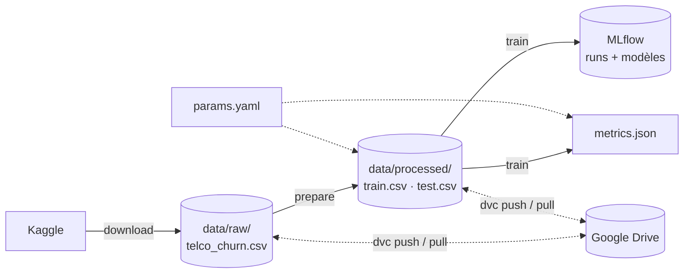
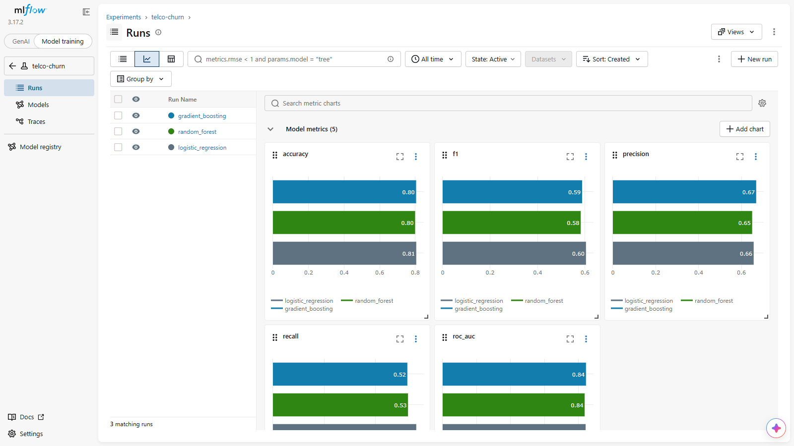
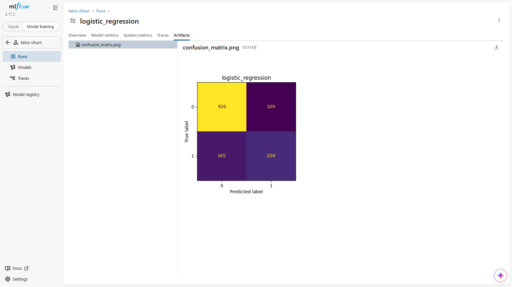

# Prédiction du churn client : pipeline MLOps avec MLflow et DVC


Projet de machine learning de bout en bout : prédire si un client d'un opérateur télécom va résilier son abonnement, en comparant plusieurs modèles.

- **DVC** versionne les données et orchestre le pipeline (`download → prepare → train`), avec stockage distant sur Google Drive.
- **MLflow** trace chaque expérience : paramètres, métriques, artefacts et modèles versionnés.
- **Git** versionne le code et les hyperparamètres (`params.yaml`).

Chaque résultat est ainsi reproductible : on sait quel code, quelles données et quels réglages l'ont produit.

## Contexte

Le **churn** (résiliation) coûte cher : retenir un client revient moins cher que d'en acquérir un nouveau. L'objectif est d'identifier à l'avance les clients à risque pour cibler des actions de fidélisation.

- **Type de problème** : classification binaire (`Churn` = Yes / No)
- **Données** : [Telco Customer Churn](https://www.kaggle.com/datasets/blastchar/telco-customer-churn) (IBM Sample Data, Kaggle) : 7 043 clients, 21 variables (profil, services souscrits, contrat, facturation)
- **Déséquilibre** : environ 26 % de clients partants

## Pipeline

Le pipeline est décrit dans [`dvc.yaml`](dvc.yaml) en trois étapes :



| Étape | Script | Rôle |
|---|---|---|
| `download` | [`src/download.py`](src/download.py) | Télécharge le CSV brut depuis Kaggle (sans compte) |
| `prepare` | [`src/prepare.py`](src/prepare.py) | Nettoie (`TotalCharges`, cible 0/1) et sépare train/test (80/20 stratifié) |
| `train` | [`src/train.py`](src/train.py) | Entraîne 3 modèles (régression logistique, Random Forest, Gradient Boosting), logue tout dans MLflow et écrit `metrics.json` |

Le préprocessing (`StandardScaler` + `OneHotEncoder`) et le modèle sont réunis dans un même `Pipeline` scikit-learn : le modèle enregistré accepte directement des données brutes.

## Versioning des données avec DVC

Les CSV ne sont **pas** stockés dans Git. Git ne garde que leur empreinte md5 (dans `dvc.lock`), et les fichiers eux-mêmes sont envoyés sur un remote **Google Drive** avec `dvc push`.

- **Exécution incrémentale** : `dvc repro` ne relance que les étapes dont le code, les données ou les paramètres ont changé. Modifier un hyperparamètre dans `params.yaml` ne relance que `train`.
- **Retour dans le temps** : `git checkout <commit> && dvc checkout` restaure le code **et** les données exactes de ce commit.
- **Lien DVC ↔ MLflow** : chaque run MLflow porte les tags `data.train_md5` et `data.test_md5`, les mêmes empreintes que dans `dvc.lock`. On sait donc sur quelle version des données chaque modèle a été entraîné.
- **Comparaison** : `dvc params diff` et `dvc metrics diff` comparent réglages et scores entre deux commits.

## Ce que MLflow enregistre pour chaque run

| Élément | Contenu |
|---|---|
| **Paramètres** | type de modèle, tous les hyperparamètres, taille des jeux train/test |
| **Métriques** | accuracy, precision, recall, F1, ROC-AUC |
| **Artefacts** | matrice de confusion (PNG) |
| **Modèle** | pipeline complet avec signature d'entrée/sortie et exemple d'input, prêt à être rechargé ou servi via `mlflow models serve` |
| **Tags** | empreintes md5 des données train/test (version DVC) |

## Résultats

Jeu de test : 1 409 clients (20 %).

| Modèle | Accuracy | Precision | Recall | F1 | ROC-AUC |
|---|---|---|---|---|---|
| Régression logistique | **0.806** | 0.657 | **0.559** | **0.604** | 0.842 |
| Random Forest | 0.799 | 0.650 | 0.527 | 0.582 | 0.836 |
| Gradient Boosting | 0.805 | **0.669** | 0.524 | 0.588 | **0.844** |

**Comparaison des 3 runs dans l'interface MLflow** (un graphique par métrique) :



**Matrice de confusion enregistrée comme artefact** (régression logistique) : sur 374 clients partants, 209 sont détectés et 165 manqués.



**Analyse**
- Les trois modèles atteignent un ROC-AUC proche de 0.84 ; le modèle le plus simple (régression logistique) obtient le meilleur F1.
- L'accuracy (~80 %) est à relativiser : prédire « reste » pour tout le monde donnerait déjà ~74 %.
- Le **recall (~55 %) est le point faible** : près d'un client partant sur deux n'est pas détecté. C'est la priorité d'amélioration pour un usage métier.

## Lancer le projet

```bash
git clone https://github.com/BassirouKadade/telco-churn-mlflow.git
cd telco-churn-mlflow
pip install -r requirements.txt

# Exécute tout le pipeline : téléchargement Kaggle → préparation → entraînement
dvc repro

# Affiche les scores
dvc metrics show

# Ouvre l'interface MLflow sur http://localhost:5000
mlflow ui --backend-store-uri sqlite:///mlflow.db --workers 1
```

Dans l'interface : **Experiments → telco-churn**, sélectionner les runs puis **Compare** pour visualiser paramètres et métriques côte à côte.

> `--workers 1` évite un plantage du serveur MLflow sous Windows ; l'option peut être omise sous Linux/macOS.

**Tester un autre réglage** : modifier une valeur dans [`params.yaml`](params.yaml) (par exemple `max_depth` du Random Forest), relancer `dvc repro`, puis comparer avec `dvc metrics diff` ou dans MLflow.

**Remote Google Drive** : le remote DVC pointe vers un dossier Google Drive privé (`dvc pull` / `dvc push` demandent donc un accès autorisé). Sans cet accès, `dvc repro` reconstruit les mêmes données depuis Kaggle.

## Structure

```
.
├── src/
│   ├── download.py    # étape 1 : téléchargement Kaggle
│   ├── prepare.py     # étape 2 : nettoyage + split train/test
│   └── train.py       # étape 3 : entraînement + tracking MLflow
├── dvc.yaml           # définition du pipeline DVC
├── dvc.lock           # empreintes des données et des sorties (généré par DVC)
├── params.yaml        # hyperparamètres et réglages
├── metrics.json       # scores du dernier entraînement
├── .dvc/config        # configuration DVC (remote Google Drive)
├── requirements.txt
├── docs/              # captures d'écran de l'interface MLflow
├── README.md
└── LICENSE
# hors Git :
#   data/              → suivi par DVC, stocké sur Google Drive
#   mlflow.db, mlruns/ → générés par MLflow
```

## Pistes d'amélioration

- Gérer le déséquilibre des classes (`class_weight="balanced"`, ajustement du seuil de décision) pour améliorer le recall
- Recherche d'hyperparamètres (GridSearch / Optuna) avec un run MLflow par essai
- Enregistrer le meilleur modèle dans le **Model Registry** et l'exposer en API REST
- Analyse de l'importance des variables (SHAP)

## Stack

Python · pandas · scikit-learn · MLflow · DVC · Google Drive · matplotlib · kagglehub

## Auteur

**Bassirou Kadade** · [GitHub](https://github.com/BassirouKadade)
