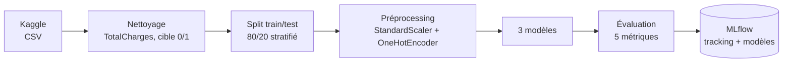

# Prédiction du churn client avec suivi d'expériences MLflow


Projet de machine learning de bout en bout : prédire si un client d'un opérateur télécom va résilier son abonnement, en comparant plusieurs modèles et en traçant chaque expérience avec **MLflow** (paramètres, métriques, artefacts et modèles versionnés).

## Contexte

Le **churn** (résiliation) coûte cher : retenir un client revient moins cher que d'en acquérir un nouveau. L'objectif est d'identifier à l'avance les clients à risque pour cibler des actions de fidélisation.

- **Type de problème** : classification binaire (`Churn` = Yes / No)
- **Données** : [Telco Customer Churn](https://www.kaggle.com/datasets/blastchar/telco-customer-churn) (IBM Sample Data, Kaggle) : 7 043 clients, 21 variables (profil, services souscrits, contrat, facturation)
- **Déséquilibre** : environ 26 % de clients partants

## Pipeline



Le préprocessing et le modèle sont réunis dans un même `Pipeline` scikit-learn : le modèle enregistré accepte directement des données brutes, sans étape de transformation à reproduire à la main.

## Ce que MLflow enregistre pour chaque run

| Élément | Contenu |
|---|---|
| **Paramètres** | type de modèle, tous les hyperparamètres, taille des jeux train/test |
| **Métriques** | accuracy, precision, recall, F1, ROC-AUC |
| **Artefacts** | matrice de confusion (PNG) |
| **Modèle** | pipeline complet avec signature d'entrée/sortie et exemple d'input, prêt à être rechargé ou servi via `mlflow models serve` |

## Résultats

Jeu de test : 1 409 clients (20 %).

| Modèle | Accuracy | Precision | Recall | F1 | ROC-AUC |
|---|---|---|---|---|---|
| Régression logistique | **0.806** | 0.657 | **0.559** | **0.604** | 0.842 |
| Random Forest | 0.799 | 0.650 | 0.527 | 0.582 | 0.836 |
| Gradient Boosting | 0.805 | **0.669** | 0.524 | 0.588 | **0.844** |

**Analyse**
- Les trois modèles atteignent un ROC-AUC proche de 0.84 ; le modèle le plus simple (régression logistique) obtient le meilleur F1.
- L'accuracy (~80 %) est à relativiser : prédire « reste » pour tout le monde donnerait déjà ~74 %.
- Le **recall (~55 %) est le point faible** : près d'un client partant sur deux n'est pas détecté. C'est la priorité d'amélioration pour un usage métier.

## Lancer le projet

```bash
git clone https://github.com/BassirouKadade/telco-churn-mlflow.git
cd telco-churn-mlflow
pip install -r requirements.txt

# Entraîne les 3 modèles (le dataset est téléchargé automatiquement depuis Kaggle)
python train.py

# Ouvre l'interface MLflow sur http://localhost:5000
mlflow ui --backend-store-uri sqlite:///mlflow.db --workers 1
```

Dans l'interface : **Experiments → telco-churn**, sélectionner les runs puis **Compare** pour visualiser paramètres et métriques côte à côte.

> `--workers 1` évite un plantage du serveur MLflow sous Windows ; l'option peut être omise sous Linux/macOS.

## Structure

```
.
├── train.py           # chargement, préprocessing, entraînement et tracking MLflow
├── requirements.txt
├── README.md
└── LICENSE
# générés à l'exécution (ignorés par git) :
#   data/  mlflow.db  mlruns/
```

## Pistes d'amélioration

- Gérer le déséquilibre des classes (`class_weight="balanced"`, ajustement du seuil de décision) pour améliorer le recall
- Recherche d'hyperparamètres (GridSearch / Optuna) avec un run MLflow par essai
- Enregistrer le meilleur modèle dans le **Model Registry** et l'exposer en API REST
- Analyse de l'importance des variables (SHAP)

## Stack

Python · pandas · scikit-learn · MLflow · matplotlib · kagglehub

## Auteur

**Bassirou Kadade** · [GitHub](https://github.com/BassirouKadade)
